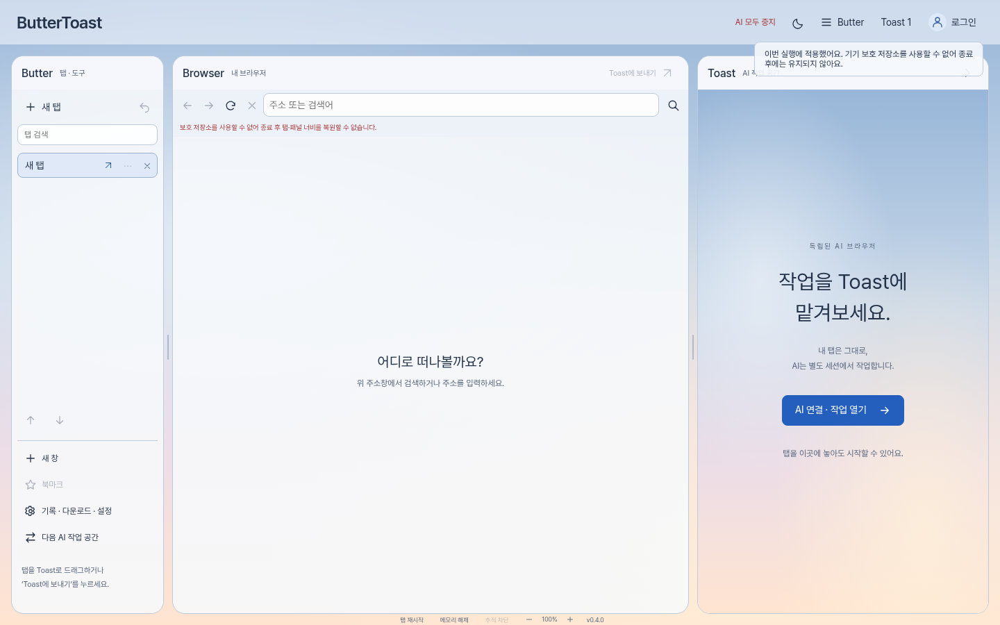

# ButterToast

ButterToast is a Chromium-based desktop browser that gives people and AI assistants separate workspaces, with explicit controls for sharing page context and approving browser actions.

사람과 AI가 각자의 공간에서 작업하고, 필요한 순간에 페이지와 제어권을 공유하는 브라우저입니다.
최근에 여러 AI 브라우저들이 나오고 있는데, 사실 저도 이런 걸 해보고 싶었지만 선례가 없어서 좀 주저했었는데 이런 선례들이 나와서 가능성 있는 아이디어라는 것을 알게 되었고, AI와 협업도 하고 도움도 받고, 필요한 순간에는 지시 사항을 주면 AI가 브라우저에서 작업을 할 수 있는 브라우저인 ButterToast를 만들었습니다.
자체 ToastIR을 통해 웹페이지의 텍스트와 상호작용 요소를 구조화된 JSON으로 변환해 AI에 전달합니다. 이를 통해 스크린샷이나 전체 HTML 전달에 드는 부담을 줄이고, 정보 처리와 브라우저 조작의 효율 향상을 목표로 합니다.

<!-- END INTRODUCTION -->

**Development preview · Windows 11 x64 · Electron / TypeScript**

[Published 0.3 download](https://github.com/Blucy1004/BUTTERTOAST/releases/tag/v0.3.0-dev.1) · [0.4 source changes](docs/GOLDEN-TOAST-0.4.md) · [Architecture](docs/ARCHITECTURE.md) · [Security](SECURITY.md) · [AI connection guide](docs/AI-CONNECTION.md)



Actual 0.4 application UI in a fresh local profile. [Dark theme](docs/design/golden-dark-workspace.png) · [Current validation](docs/GOLDEN-TOAST-0.4.md).

## How it works

ButterToast organizes the browser into three areas:

- **Butter** — human-owned tabs, bookmarks, history, downloads and browser settings.
- **Browser** — the active page used directly by the person.
- **Toast** — an AI workspace with its own browsing session, model connection and task controls.

A person can share a page for reading, authorize control of a human tab, or open an address in a separate AI session. Sending a tab to Toast opens its address while preserving the original tab; website cookies and login state are not copied into the AI session.

AI models propose structured actions. The application checks their scope, document identity, page version and target before execution. Clicks, form fills, selections, scrolling and navigation require native user approval. A global stop control revokes pending AI work across all three AI slots.

## Current capabilities

| Area | Implemented capabilities |
| --- | --- |
| Browsing | Tabs and drag ordering, local address suggestions, pinning, muting, reopening, session restoration, page search, zoom, hard reload, additional browsing windows and opt-in memory saving |
| Browser management | Bookmarks/history imports, encrypted download history, native download/popup approval, site permissions, privacy settings and search-provider selection |
| AI connections | OpenAI, Anthropic Claude, Google Gemini, OpenAI-compatible endpoints and supported local model servers |
| AI collaboration | Three independent model workspaces, explicit page sharing, per-action approval, bounded multi-step tasks, handoff and emergency stop |
| Accounts | Supabase email sign-up, email confirmation, sign-in, sign-out, password recovery, password changes, opt-in remembered login and other-session sign-out |
| Profiles and appearance | Account nickname, bio and six vector avatars; dark/light/system themes, accents, backgrounds, text size, spacing, corners and reduced effects; local preview and account save/reload |
| Reliability | Human-tab restart, suspended-tab restoration and consent-based recovery of AI task pages in a fresh isolated session |
| Usage visibility | Provider-reported token usage, user-configured cost estimates, ToastIR capture/payload metrics and optional encrypted conversation archives |

Search opens the selected search engine's normal results page. The optional Google theme applies local styling to supported search pages.
ButterToast is an independently developed project. This repository does not claim approval, certification or endorsement by OpenAI or other model providers.

### User control over AI access

1. Choose a provider and enter a key inside the application's connection settings. Supported local servers can be configured without a key.
2. Choose a model. Model-list retrieval confirms connectivity; it does not verify inference quality or task success.
3. Share page context explicitly, or approve a bounded workflow that can recapture the authorized task page.
4. Review proposed actions and their target site before approving execution.
5. Stop work or revoke sharing at any time. Effects already accepted by a website or model provider cannot be undone by stopping the application.

## Data handling

| Data | Handling |
| --- | --- |
| Model API keys | Kept in the main process; optionally saved using OS-protected encryption. Sent to the selected provider or configured endpoint. Not stored in Supabase. |
| Prompts and shared page context | Sent to the selected model provider when the user submits a request. Page sharing is explicit; bounded workflows require separate consent. |
| ButterToast account credentials | Sent over HTTPS to Supabase Auth for the requested authentication operation. Access tokens remain in main-process memory. Remembered login is opt-in and stores only refresh credentials and identity binding with OS encryption. |
| Account profile and appearance | Local OS-protected storage by default. Per-account/device opt-in enables Supabase Auth metadata reads/writes; disabling stops future profile sync but leaves existing server data. No real-time cross-device updates. |
| Bookmarks, history and device settings | Managed locally; persisted using OS-protected encryption when available. Guest appearance also stays on this device. |
| Conversation archives | Saved locally only on explicit request, using OS-protected encryption. |
| AI action audit records | Limited to metadata such as time, site origin, action and outcome; input values and API keys are excluded. |

The application calls model providers directly; it does not operate a central inference relay. Model-provider and authentication-service data policies still apply to requests sent to those services.

Website sessions are handled by Chromium. Human browsing, AI task sessions, application UI, model networking and account networking have distinct security boundaries. ButterToast account sign-in does not itself grant an AI permission to access browsing data or execute actions.

Changing ButterToast accounts changes the displayed profile and appearance. Browsing data, website sessions, saved AI connections and conversation archives remain in the same OS user profile; they are not isolated by ButterToast account or synced to Supabase.

When OS-protected storage is unavailable, protected application data stays in memory or saving fails explicitly. API keys are never silently stored through a plaintext fallback. See [Security](SECURITY.md) and the [AI connection guide](docs/AI-CONNECTION.md) for the precise scope and limitations.

## Security architecture

ButterToast retains Chromium sandboxing, Site Isolation, context isolation and TLS certificate verification. Website content receives no Node.js access or application IPC bridge. Application views load from a fixed local asset allowlist with a restrictive Content Security Policy.

The AI execution path has three parts:

- **ToastIR** builds a bounded page representation and maintains document and element identities.
- **ToastCore** executes supported structured operations through the browser.
- **ToastGuard** enforces permissions, document freshness, target validity and one-time approval.

Model responses and webpage content are treated as untrusted input. The model cannot submit arbitrary JavaScript, OS commands or permission grants through the action protocol. Sensitive input fields, stale targets, cross-document approvals and replayed approvals are rejected.

Downloads require native confirmation and a destination selected by the user. Redirect chains and filenames are checked, and Windows downloads receive Internet-zone metadata when the filesystem supports it. These controls do not replace malware scanning.

Security tests cover malicious page fixtures, element substitution, forged IPC, approval bypass attempts, session isolation, cancellation races, renderer crashes, profile injection and update tampering. Results and remaining risks are documented in [Security](SECURITY.md), [implementation status](docs/IMPLEMENTATION-STATUS.md) and [0.4 validation notes](docs/GOLDEN-TOAST-0.4.md).

## Download and run

**Source version 0.4.1 is prepared locally and has not been published as a new release.** See the [Toast Torture QA report](docs/QA/TOAST-TORTURE-REPORT.md) for local tests and remaining limits. The current downloadable preview is [**v0.3.0-dev.1**](https://github.com/Blucy1004/BUTTERTOAST/releases/tag/v0.3.0-dev.1).

- [Windows installer](https://github.com/Blucy1004/BUTTERTOAST/releases/download/v0.3.0-dev.1/ButterToast-0.3.0-Setup-x64.exe)
- [Windows portable ZIP](https://github.com/Blucy1004/BUTTERTOAST/releases/download/v0.3.0-dev.1/ButterToast-0.3.0-Windows-x64.zip)
- [SHA-256 checksums](https://github.com/Blucy1004/BUTTERTOAST/releases/download/v0.3.0-dev.1/SHA256SUMS.txt)

Close an existing ButterToast instance before running the installer. For the portable build, extract the complete archive and run `ButterToast-win32-x64/ButterToast.exe`; its DLLs and `resources` directory must remain alongside it. GitHub's source-code archives do not contain the executable.

These are **unsigned development builds**. Actual installation, upgrade and removal on end-user Windows machines remain separate validation steps. See the [Windows build guide](docs/WINDOWS-TEST-BUILD.md).

## Development

Use Node.js 24 LTS, npm and an operational Chromium sandbox.

```sh
npm ci
node scripts/install-electron.cjs
npm start
```

Validation and packaging:

```sh
npm test
npm run test:security
npm run benchmark
# Optional Chrome comparison: see docs/performance/GOLDEN-TOAST-0.4.md
npm run benchmark:golden
npm run package:win
# Requires NSIS / makensis
npm run package:installer
```

The CI workflow runs security regressions on Windows and Ubuntu. Packaging verifies the application payload, Windows executable architecture, Electron fuses and embedded ASAR integrity. Release assets include checksums, a build-verification report and an SBOM.

[CI results](https://github.com/Blucy1004/BUTTERTOAST/actions/workflows/security.yml) · [Release setup](docs/RELEASE-SETUP.md) · [Supabase configuration](docs/SUPABASE-SETUP.md)

## Project status

ButterToast is in active development. Implemented behavior, local fixture tests, CI validation and live-service validation are tracked separately. The source changes and current tests are in [the 0.4 notes](docs/GOLDEN-TOAST-0.4.md); the separately linked published download still has [0.3 behavior](docs/PROFILE-THEMES-0.3.md). Profile saving and account switching have local fixture coverage; live Supabase profile writes and reads from another device still need validation.

Live model inference and complex website task success, production email delivery, end-user Windows installation, Authenticode signing and an operational update service require further validation or configuration. Automatic updates are currently disabled. Passing tests does not establish that a browser is free of vulnerabilities or that every prompt-injection attempt is prevented.

Core browsing, BYOK, ToastIR and basic task history remain free, without plan-based artificial delay. Paid plans and payments are not active. The official ChatGPT connection remains disabled pending eligibility/approval and implementation; see the [official integration investigation](docs/CHATGPT-OFFICIAL-INTEGRATION.md).

Performance targets in the project requirements are goals, not measured guarantees. [Local measurements and their limits](docs/performance/GOLDEN-TOAST-0.4.md) include 10/25/50 tabs and an official Chrome reference; they do not establish Chrome parity. The project owner retains final UI/UX direction; browser logic and replaceable UI components remain separated.

## Third-party notices

ButterToast uses Electron/Chromium and other components under their respective licenses. The bundled Pretendard font is distributed under the [SIL Open Font License](src/fonts/OFL-Pretendard.txt); its [source and checksum](src/fonts/README.md) are included in the repository and distribution.

Additional technical documentation is available in the [`docs`](docs) directory, primarily in Korean.
