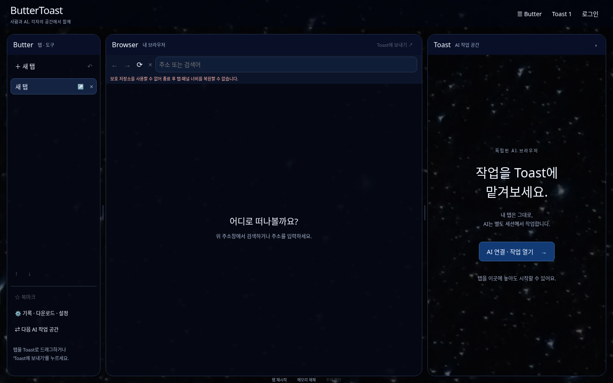

# 오너 디자인 적용 — 2026-11-08

입력은 `ButterToast_Codex_Design_Brief.html`과 “중앙에서 벗어나거나 매끄럽지 않은 선·디자인은 수정해도 된다”는 후속 요청이다. [브리프](design/BRIEF.md)의 수정된 시안을 기준으로 기존 브라우저·계정·AI 구현을 유지했다. 오너의 왼쪽 Butter / 중앙 Browser / 오른쪽 Toast 역할을 보존한다.

## 기존 구현과 차이

기존에는 가로 탭 바, 흰색 브라우저 셸, 채팅 중심 AI 사이드바와 별도의 AI 작업 창이 있었다. 현재는 세로 탭·도구의 Butter, 사람용 Browser, 상태/실제 웹페이지가 중심인 Toast를 한 창에 배치한다. 별·네이비 분위기는 오너가 제공한 원본 이미지로 표현하고 정렬, 간격, 테두리와 모서리를 보정했다. 배경 이미지의 문구/버튼을 화면처럼 사용하는 대신 실제 HTML 텍스트와 버튼을 구현했다.

## 단계별 적용

| 단계 | 구현 |
| --- | --- |
| 1. UI | 3패널, 마우스·키보드 너비 조절, OS 암호화로 너비 저장·복원, 양옆 접기, 작은 창의 축소/전환, 공통 디자인 토큰 |
| 2. 작업 전달 | 왼쪽 탭 드래그 및 ‘Toast에 보내기’, 네이티브 확인, 원본 탭 유지, 독립 AI 세션, 같은 작업의 상태/실제 페이지 전환, 일시정지·재개·직접 개입·종료, 결과 주소를 중앙 새 탭으로 가져오기 |
| 2. 선택 공유 | 명시적으로 선택한 단일 텍스트 영역의 미리보기. 모델 전송은 별도 전송 버튼으로 진행. 입력란·비공개 영역은 제외 |
| 3. 시각화 | 실제 승인된 CLICK/FILL/SELECT 결과의 위치에 가상 커서 표시, 파란 잔상, 시각·요소·동작·결과 로그, 1×/0.5×/0.1× 기록 재생, 애니메이션 끄기와 OS 모션 감소 반영 |
| 4. 검증 | 중앙/AI 독립 탐색, 세션 유지, 원본 데이터 보존, 네이티브 마우스 드래그, UI/Chromium 뷰 좌표 일치, 재생의 비실행성, 기존 보안 회귀와 표현 수집 벤치마크 |

브리프의 “광속”은 모드의 디자인 방향이다. 응답/진행/승인 상태를 실제 상태에 맞게 표시하며 화면을 숨겼다는 이유로 AI가 빨라졌다고 주장하지 않는다. 로그의 `executed`는 브라우저 동작 실행 결과이며 외부 사이트의 거래·업무 결과까지 성공했다는 뜻은 아니다.

## 주요 변경 파일

- `src/index.html`, `style.css`, `tokens.css`, `workspace.js`, `tabs.js`, `ui.js`: 3패널과 실제 입력·드래그·접기 컴포넌트.
- `src/browser/workspace.ts`, `library.ts`, `tabs.ts`, `src/main.ts`: 메인 소유 뷰 좌표, 제한된 너비 IPC, 저장과 세션 유지.
- `src/ai/panel.ts`, `workspaces.ts`, `ai.html`, `ai.css`, `ai.js`: 내장된 작업 뷰, 표시 모드, 전달·결과·작업 제어.
- `src/ai/visualizer.ts`, `cursor.html`, `cursor.css`: 앱 소유의 무권한 커서 뷰. 페이지 DOM에 커서 코드를 주입하지 않음.
- `src/toastir/runtime.ts`, `controller.ts`, `src/ai/protocol.ts`, `service.ts`: 승인된 실행 이벤트, 제한된 선택 공유, 숨김/중지 의미 분리.
- `test/workspace.test.cjs`, `workspace-security.cjs`, `scripts/test-workspace.cjs`: 새 수용·공격 회귀. 전체 검사와 CI에 포함.

## 검증 범위

`npm run test:workspace`는 실제 Electron에서 8개 그룹을 검사한다. DOM 레이아웃과 실제 WebContentsView bounds를 비교하며 실제 마우스 드래그가 네이티브 승인으로 이어지는 경로를 실행한다. Query/fragment의 테스트 토큰·사람 쿠키·입력값이 자동 복사되지 않는지, 숨긴 패널의 위조 IPC가 작업을 종료하지 못하는지 확인한다. 기존 AI 회귀는 내장된 작업 뷰에 맞는 최소 너비/높이로 실행하며 승인 우회·요소 바꿔치기 검사를 유지한다.

단위 테스트는 총 79개, Electron은 기존 94개와 새 8개 그룹이다. 최종 `npm run test:security`에서 모두 통과했고 npm audit은 알려진 취약점 0건, 지원 비밀정보 패턴은 미검출이었다. 로그는 `/tmp/bt-design-final-security.log`이며 해당 커밋의 GitHub Actions에서 OS별 결과를 확인한다. 실제 유료 모델 호출 대신 로컬 응답 fixture를 사용한다. Linux 화면 캡처를 확인했고 Windows의 실제 마우스 감각·설치/제거는 별도 수동 확인 대상이다.

## 동일 로컬 fixture 표현 측정

200개 section, 1050×720, 워밍업 1회 후 5회 중앙값이다. ToastIR의 선택 공유 추가 전후에 수집 표현 구조는 동일하다.

| 표현 | 크기 | 수집 중앙값 |
| --- | ---: | ---: |
| DOM HTML | 125,726 bytes | 1.54 ms |
| ToastIR JSON | 72,411 bytes | 6.50 ms |
| ToastIR 바이너리 | 2,974 bytes | 별도 인코딩 |
| 화면 PNG | 80,928 bytes | 25.14 ms |

이 값은 한 로컬 fixture의 표현 수집 비용이다. 전체 DOM/IR과 화면 PNG는 담는 범위가 다르고, 이전 실행과의 시간 차이는 UI 변경의 성능 향상 증거가 아니다. 실제 모델 토큰·비용·반복 작업 성공률·전체 소요 시간의 동등 조건 비교는 실제 모델 연결 후 해야 한다. 근거 없는 속도/토큰 절감 수치는 표시하지 않는다.

## 남은 제약

- 자동 탭 전달은 검색 인자와 fragment를 제외한다. 필요한 전체 URL은 작업 주소 입력란에 사용자가 직접 입력할 수 있다. 쿠키·로그인 상태는 자동 복사하지 않는다.
- 선택 공유는 단일 가시적 텍스트 영역만 지원한다. 여러 요소를 가로지르는 선택과 입력란 선택은 제외한다.
- 커서 기록은 슬롯당 최근 200개를 메모리에 보관한다. 문서나 뷰포트가 바뀌면 옛 좌표를 현재 페이지 위에 재생하지 않는다. 재생은 원래 페이지의 영상 녹화가 아니다.
- 패널 너비는 OS 보호 저장소가 있을 때만 지속 저장한다. 없으면 현재 실행에서만 유지하고 UI에 알린다.
- 작은 창에서는 Butter를 축소하고 Browser/Toast를 전환한다. 넓은 창에서는 세 영역을 동시에 표시한다.
- iframe/shadow DOM 전체 조작, 실제 모델 성능 목표, 일반 사용자 SMTP, 서명된 운영 배포와 Windows 설치 검증은 아직 별도 작업이다. 상세 설정·계정 UI에는 추가 오너 디자인을 적용할 수 있다.
