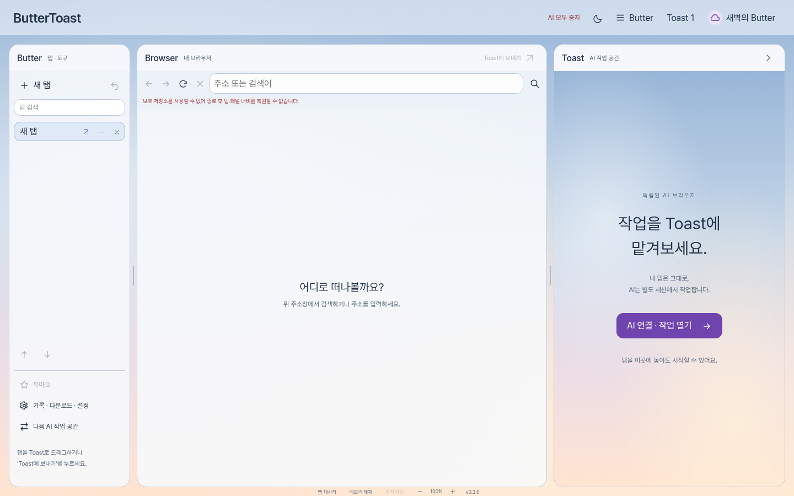
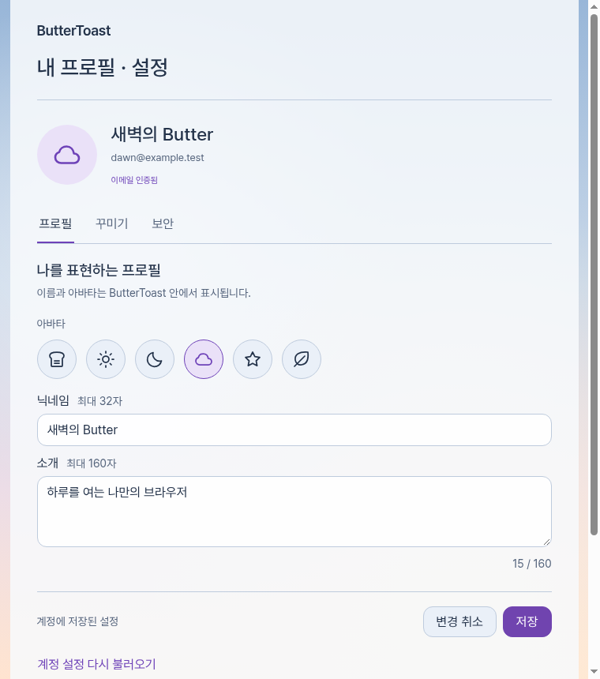

# 0.3 라이트 테마·계정 프로필·아이콘

2026-11-08. 기존 Butter / Browser / Toast 구조에 새벽빛 라이트 테마, 계정별 프로필·꾸미기와 로컬 SVG 아이콘을 추가했다. 최종 UI/UX 결정권은 프로젝트 오너에게 있다.

실제 Electron 앱에서 촬영한 화면이다. 이름·이메일·프로필은 자동 검사에서 사용하는 예시 데이터이며 실제 사용자 계정이 아니다.

## 사용법

상단 태양·달 아이콘으로 라이트/다크를 전환한다. 로그인한 뒤 상단 프로필을 누르면 **프로필 / 꾸미기 / 보안**을 연다. 계정 없이도 브라우저와 테마 전환을 사용할 수 있다.

| 설정 | 지원 범위 |
| --- | --- |
| 프로필 | 닉네임 32자, 소개 160자, 토스트·태양·달·구름·별·잎 아바타 |
| 테마 | 다크, 새벽빛 라이트, 시스템 설정 따르기 |
| 강조색 | 블루, 라벤더, 로즈, 민트, 앰버 |
| 배경 | 테마에 맞게, 새벽빛 하늘, 별이 있는 밤, 단색 |
| 글자 크기 | 작게, 기본, 크게 |
| 목록·설정 간격 | 여유롭게, 촘촘하게 |
| 버튼·입력칸 모서리 | 부드럽게, 둥글게, 각지게 |
| 화면 효과 | 시스템 설정 따르기, 효과 줄이기 |

꾸미기의 미리보기는 저장 전까지 편집 창 안에서만 바뀐다. 저장 성공 후 메인·계정·관리·AI 패널에 함께 적용한다. 다른 창에서 테마를 바꾸면 저장하지 않은 편집 내용은 유지하고, 변경 취소나 다시 불러오기를 안내한다. 글자 크기는 앱 UI 설정이며 웹사이트 본문은 브라우저 확대 기능으로 조절한다. 화면 효과 설정은 AI 실행이나 승인을 바꾸지 않는다.

[꾸미기 화면](design/profile-appearance.png). 아바타는 앱에 포함된 6개 벡터 아이콘이며 외부 사진 업로드는 지원하지 않는다. 화살표·닫기·검색·설정·탭 상태도 문자/이모지 대신 같은 로컬 SVG 컴포넌트를 사용한다. 아이콘 색과 크기는 디자인 토큰을 따르고 버튼의 접근성 이름·키보드 조작은 유지한다.

## 저장과 동기화

프로필은 Supabase Auth의 `user_metadata.buttertoast_profile`에 버전 1 형식으로 저장한다. 현재 로그인한 세션으로 고정된 Auth `/user` 경로에 GET/PUT을 보내며, PUT의 `data`에는 해당 namespace만 포함한다. 관리자 키·추가 DB 테이블·Storage 버킷은 필요 없다.

로그인하거나 **계정 설정 다시 불러오기**를 누르면 서버의 프로필을 읽는다. 기기 간 실시간 푸시나 서버의 조건부 갱신은 구현하지 않았다. 다른 기기에서 동시에 수정하면 나중에 저장한 전체 프로필이 우선한다. 앱 내부 revision은 같은 실행에서의 오래된 편집을 막는 장치이며 서버의 동시성 제어는 아니다.

계정 없이 바꾼 테마는 기존 OS 암호화 라이브러리에 저장한다. OS 암호화를 사용할 수 없으면 메모리에만 둔다. 로그인하면 계정 설정을 적용하고 로그아웃·세션 만료 시 이 기기의 비로그인 테마로 돌아간다. 인증 토큰은 계속 메인 프로세스 RAM에만 있어 앱 재시작 후에는 다시 로그인해야 한다.

방문 기록·북마크·웹사이트 로그인·AI 키·대화는 Supabase 프로필로 보내지 않는다. 이 데이터는 기존 OS 사용자 프로필에 남으며, **ButterToast 계정 전환이 브라우저 데이터까지 별도 사용자 공간으로 분리하지는 않는다.** 서버가 이미 수락한 프로필 저장은 이후 로그아웃으로 소급 취소되지 않는다.

0.2 라이브러리에는 없는 `appearance` 필드를 기본값으로 읽는다. 새 형식에 이 필드가 저장되면 이전 앱에서 라이브러리를 읽지 못할 수 있어 다운그레이드 호환성을 보장하지 않는다. 탭 저장의 v1→v2 규칙은 [0.2 기록](UPGRADE-0.2.md)과 같다.

## 보안 경계

- 메타데이터는 표시용 데이터다. 사용자 ID·역할·권한·CSS·URL·SVG를 입력받지 않는다. 이름과 소개는 길이·제어 문자·방향 제어 문자를 제한하고 `textContent`로 표시한다.
- 저장·재읽기에는 현재 메인 소유 세션과 revision이 필요하다. 응답의 사용자 ID·이메일·인증 상태를 확인하고, 저장 응답에는 실제 요청한 프로필이 있어야 성공 처리한다. JSON 키 순서 차이는 정규화한다.
- 로그아웃·만료·다른 계정 로그인 이후 도착한 응답은 버린다. 중복 저장과 짧은 간격의 저장을 제한한다. 로그아웃은 일반 IPC 한도가 소진되어도 가능하지만 발신자·프레임·스키마 검증은 유지한다.
- 테마 전달은 등록된 앱 WebContents와 정확한 최상위 URL만 허용한다. 테마 채널에는 이름·이메일·토큰이 없다. 같은 URL을 연 위조 창이나 웹페이지는 읽기/저장을 할 수 없다.
- 아이콘은 `icons.js`의 고정 path로만 생성한다. 외부 SVG·사용자 마크업·원격 아이콘 CDN을 로드하지 않으며, 기존 자산 허용 목록과 CSP를 유지한다.
- UI 변경은 웹 콘텐츠의 샌드박스, 네이티브 뷰 배치, ToastIR/Core/Guard 승인 경계를 바꾸지 않는다.

## 검증 범위

`npm run test:security`는 단위 검사 97개와 실제 Electron 로컬 회귀 121개 그룹을 실행한다. 이 중 프로필 관련 추가 검사는 단위 9개와 Electron 9개 그룹이다. Chromium sandbox와 TLS 검증을 유지한다.

| 추가 검사 | 확인 내용 |
| --- | --- |
| 스키마·저장 | 허용 옵션, 길이, 정규화, 금지 필드, 보호 저장소, 이전 라이브러리 읽기 |
| 인증 바인딩 | 현재 bearer/namespace만 사용, 다른 ID·이메일·미인증 응답·누락된 저장 결과 거부 |
| 경쟁 상태 | 오래된 revision, 동시 저장, 로그아웃/계정 전환 후 지연 응답, 입력 변경 분리 |
| 실제 UI | 로컬 새벽 배경, 미리보기/저장, 4종 창에 적용, 시스템 테마 변경, 작은 창 배치 |
| 공격 fixture | 같은 URL 위조 창, HTML 프로필명, CSS/외부 아바타 주입, IPC 폭주 중 로그아웃 |
| 계정 전환 | 편집 입력 지우기, 비로그인 테마 복원, A/B 계정 프로필 구분 |

로컬 Linux의 전체 검사는 97개 단위 검사와 121개 Electron 그룹이 모두 통과했고, npm audit은 보고된 취약점 0건, 지원되는 비밀정보 패턴은 미검출이었다. 아이콘 곡선 최종 조정 후 프로필 Electron 9개 그룹도 다시 통과했다. npm audit과 패턴 검사는 Chromium 전체 CVE나 모든 유출을 분석하지 않는다.

로컬 결과와 해당 커밋의 Windows·Ubuntu CI 결과는 각각 확인한다. [Security regression](https://github.com/Blucy1004/BUTTERTOAST/actions/workflows/security.yml)이 성공한 소스의 Windows artifact만 릴리스에 사용한다. 검사 수는 독립 취약점 수가 아니다.

프로필 서버 응답은 로컬 fixture로 검증했다. **실제 Supabase 계정에 프로필 쓰기·다른 기기에서 재읽기는 아직 검증하지 않았다.** 예전 가입/메일 확인 기록을 이번 프로필 실서비스 검증으로 취급하지 않는다. 실제 AI 추론·복잡한 사이트 작업·일반 사용자 SMTP·Windows 설치/덮어설치/제거·코드 서명·운영 업데이트 검증도 별도로 남아 있다. 자동 검사 통과가 취약점 부재를 보증하지 않는다.

## 구현 위치

- `src/profile/model.ts`: 데이터 스키마와 기본값
- `src/profile/appearance.ts`: 메인이 소유하는 테마 상태와 허용 UI에 전달
- `src/auth/service.ts`: 현재 계정에 묶인 프로필 저장·재읽기
- `src/profile.js`, `src/account.html`: 교체 가능한 프로필 편집 UI
- `src/tokens.css`, `src/appearance.js`, `src/icons.js`: 테마 토큰·표시·로컬 벡터 아이콘
- `test/profile.test.cjs`, `test/profile-security.cjs`: 단위·실제 Electron 회귀
