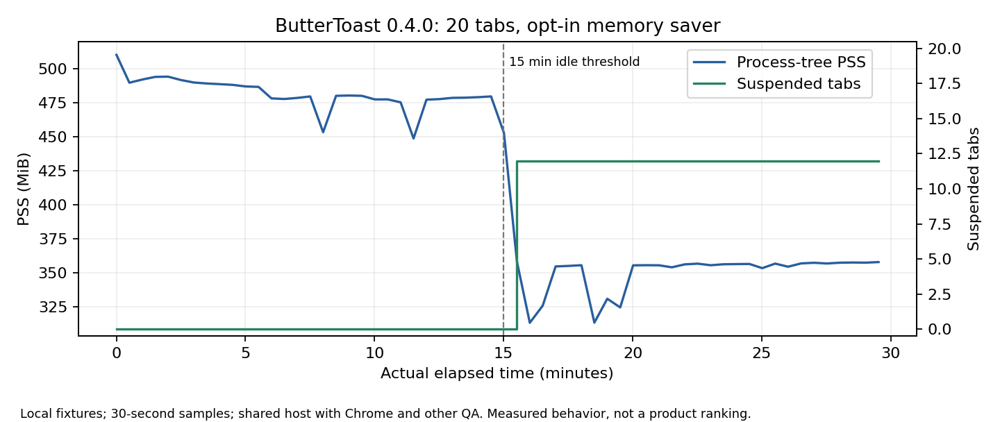

# Operation Toast Torture — 완료

ButterToast **0.4.0을 기준으로 조사하여 0.4.1 개발 빌드에 결함 3건을 수정했다.** 실제 AI 키·모델·OAuth 없이 로컬 fixture로 검증했다. 공개 Release를 게시하지 않았다. Windows 실기기 검증 전이므로 일반 배포 준비 완료로 판정하지 않는다.

## 환경·대상

- 시작 커밋: `d22be6e954eac38b61cd66b2f3159502d77e9b45` / 0.4.0, 작업 트리 깨끗함. 기존 0.4.0 EXE·ZIP 보존.
- 수정 소스 커밋: `63b917b` / 0.4.1. 보고서·측정 데이터는 후속 문서 커밋. 테스트 중 사용자 변경을 덮어쓰지 않음.
- Linux x64, kernel 6.18.57, glibc 2.41. Node 24.22.1, Electron **45.2.3**, Chromium **156.0.8078.80**, Electron 내 Node 24.22.2.
- AMD EPYC 7763, 논리 CPU 5개 노출, cgroup CPU quota **4 코어**, RAM 약 33.29 GiB 노출/32 GiB cgroup, swap 0. [환경 원자료](data/environment.json).
- 비교: 별도 공식 **Google Chrome for Testing 157.0.8103.38**. 일반 사용자 Stable Chrome과 버전이 다르다.
- 장시간 시험: Linux headless, GPU 비활성, sandbox/Site Isolation/TLS 유지. native 입력: 인증된 Xvfb :92, TCP listener 없음. D-Bus/keyring 부재로 실제 OS 비밀 저장은 미검증.
- 새로운 임시 프로필만 사용. 저장/강제 종료 복구는 테스트 전용 AES-GCM cipher 주입. 프로덕션에 plaintext fallback이나 Mock 설정을 추가하지 않음.
- 모든 시각 원자료는 UTC ISO8601이다. A 시작은 2026-11-09 06:33:55 UTC. 측정 시간을 짧게 가속하지 않았다.

## 실행·집계

[재현 명령과 전제](README.md). `npm run test:security`, `npm run test:torture`, 실제 앱 Mock DOM 경로, native display 입력, `torture-long`, 강제 종료 복구, `ir-benchmark`, startup과 Mock 병행 브라우징을 실행했다.

| 최종 기능·보안 검사 묶음 | 통과 | 실패 | 미검증 |
| --- | ---: | ---: | ---: |
| 단위/모듈 (`npm test`) | 120 | 0 | 0 |
| 실제 Electron 보안/브라우저/계정/UI 회귀 그룹 | 133 | 0 | 0 |
| HTTP Mock 공급자 | 9 | 0 | 0 |
| 실제 Mock→UI→ToastIR DOM/탐색/취소 | 27 | 0 | 0 |
| 멈춘 renderer 실행 deadline 회귀 | 1 | 0 | 0 |
| Xvfb native 포인터/키/Enter/파일 선택 요청 | 4 | 0 | 0 |
| SIGKILL 뒤 10 URL 복구 (테스트 cipher) | 1 | 0 | 0 |
| Mock AI와 10탭 병행 브라우징 | 1 | 0 | 0 |
| 실제 DOM 변경분 직렬화/재구성/불량 baseline | 1 | 0 | 0 |
| 로컬 VP9 및 multipart 업로드 | 1 | 0 | 0 |
| **합계 (테스트/그룹 단위, assert 수 아님)** | **298** | **0** | **0** |

이 집계는 아래 성능 반복 시행 수와 중복 합산하지 않는다. 별도 성능 측정은 최종 **42/42 성공**, 수정 전 ToastIR 탐색/SPA **6/21 실패**를 보존했다. 장시간 A/B/C는 **6/6 완료**. Chrome D 자동 세션 복구는 **1개 시나리오 실패**(headless와 Xvfb에서 재현), 수동 복구는 미검증이다. 아래 미검증 범위는 **10개 검증 항목**으로 따로 집계한다.

원자료: [전체 보안 결과](data/security-summary.txt), [Mock 공급자 TAP](data/provider.tap), [실제 AI/DOM 결과](data/ai-dom-verified.json), [실행 제한 전](data/blocked-renderer-baseline.json)/[후](data/blocked-renderer-fixed.json), [native 입력](data/native-browser.json).

## Mock·ToastIR·보안

- Test-only loopback HTTP 공급자가 실제 `/v1/models`, `/v1/chat/completions` 인터페이스를 사용한다. 키 입력은 거부한다. 정해진 응답·지연·chunked JSON·SSE·잘못된 JSON·초과 크기·401/403/400/404/429/500·사용자 abort·body 중단·재시도를 검사했다.
- AiService의 **실제 60초 timeout은 60,002ms에 종료**했고 다음 명시적 재시도가 성공했다. 실제 모델 응답/추론/청구 성공을 의미하지 않는다.
- 앱은 현재 `stream:false`를 보낸다. Mock의 chunked JSON은 조립하지만 unsolicited SSE는 안전하게 거부한다. **스트리밍 UI는 미지원**이다.
- CLICK/FILL/checkbox/SELECT/SCROLL/link/form POST/READ/VERIFY/EXTRACT의 실제 DOM 값·이벤트·목적지·서버 요청·관찰 결과를 확인했다. 열린/nested shadow, 동적 요소, 제거/재생성, 이동, SPA와 문서 교체도 검사했다. 닫힌 shadow 내용은 읽지 않는다.
- 실제 full/delta 프레임을 JSON round-trip 뒤 재구성하고 필드 누락·중복/불일치 baseline을 거부했다. 실행 ID/문서/범위/승인 재검증은 별도로 유지한다.
- `contextIsolation:true`, `sandbox:true`, `nodeIntegration:false`, `webSecurity:true`와 제한된 preload, 실제 발신 창/프레임 IPC 검증을 확인했다. 로컬 악성 페이지의 명령/승인 주입, stale/교체 대상, 탭 간 저장소, 외부/파일 URL, 권한·다운로드·토큰 노출 방어도 회귀했다.
- `npm audit`: 보고 취약점 0. secret scanner: 지원 패턴 미검출. 이는 Chromium 전체 CVE·제로데이·모든 비밀 유출 부재의 증명이 아니다. SBOM과 패키지 fuse/ASAR 검사는 별도 빌드 기록에 남긴다.

## 브라우저 기본 기능

| 기능 | 실제 증거와 판정 |
| --- | --- |
| 새 탭 | production UI IPC, 10/20/50 logical tabs 생성 — 통과 |
| 탭 닫기 | WebContents 파괴와 최근 닫은 URL 복원 — 통과 |
| 탭 전환 | 활성 ID/실제 페이지 및 입력 확인 — 통과 |
| 탭 드래그 | 앱 UI의 native 포인터 드래그 순서 검사 — 통과 |
| 탭 고정 | native 메뉴와 고정 순서/일괄 닫기 보존 — 통과 |
| 새 창 | 별도 toolbar/내용과 sandbox 검사 — 통과 |
| 주소 검색 | 실제 Enter sequence로 Google 검색 URL 이동; 응답은 로컬 fixture — 통과 |
| 주소 추천 | 로컬 bookmark/history에서 실제 UI suggestions — 통과 |
| 방문 기록 | manager에 실제 탐색 이력 표시 — 통과 |
| 북마크 | 생성/표시/삭제 IPC 및 불신 제목 렌더링 — 통과 |
| 다운로드 기록 | 승인된 실제 전송·완료 목록·암호화 목록 복원 모듈 — 통과 |
| 파일 업로드 | native chooser 요청, CDP fixture 선택, 실제 multipart 수신 — 통과; OS chooser 조작 미검증 |
| 새로고침 | 실제 페이지 다시 로드 및 스트레스 중 반복 — 통과 |
| 뒤로 | 실제 탐색 history — 통과 |
| 앞으로 | 실제 탐색 history — 통과 |
| 확대·축소 | native 명령과 활성 WebContents zoom/viewport — 통과 |
| 세션 저장 | 암호화 checkpoint, URL의 평문 미저장 — 통과 (테스트 cipher) |
| 세션 복구 | SIGKILL/재시작 뒤 10개 실제 URL/본문 — 통과 (테스트 cipher) |
| 메모리 절약 | 실제 15분 idle 뒤 12개 탭 해제, 30분 종료 후 20개 URL 복구 — 통과 |

## Chrome 비교

동일 로컬 fixture, 742×686 콘텐츠 viewport, 탭 수와 동작 순서를 사용했다. A=10탭/15분, B=20탭/30분(8개 활성, 12개 idle), C=50탭/5분. 두 브라우저가 같은 호스트에서 동시 실행했고 다른 QA 부하도 있었다. A/B/C는 수정 전 **0.4.0 고정 dist**를 사용해 실행 중 변경과 섞이지 않았다. 0.4.1은 ToastIR/AI 경로만 수정했으며 BrowserTabs 메모리/충돌 로직은 동일하다.

B는 ButterToast 메모리 절약 ON, Chrome은 기본 설정이다. ButterToast 드라이버는 IPC 빈도 제한을 위해 명령 전 **125ms 대기**를 포함하며 Chrome은 CDP를 쓴다. 아래 전환/로드 시간은 이 드라이버 비용을 포함하므로 순수 UI 지연으로 해석하지 않는다. 엔진 버전과 정책·드라이버·동시 부하 차이 때문에 **직접적인 성능 우열을 주장하지 않는다**.

| 시나리오 | 엔진 | monotonic / wall 초 | PSS / RSS 중앙값 MiB | CPU 차분 중앙값 %* | 전환 중앙값 ms | 로드 중앙값 ms | 비의도 충돌 / 응답 없음 |
| --- | --- | ---: | ---: | ---: | ---: | ---: | --- |
| A | ButterToast full app | 900.56 / 900.56 | 374.08 / 914.23 | 3.13 | 129.27 | 166.75 | 0 / 0 |
| A | Google Chrome for Testing | 901.89 / 901.89 | 650.66 / 2,964.65 | 4.10 | 24.51 | 31.35 | 0 / 미계측 |
| B | ButterToast full app | 1,801.08 / 1,801.08 | 450.62 / 1,367.96 | 3.53 | 129.19 | 169.75 | 0 / 0 |
| B | Google Chrome for Testing | 1,801.74 / 1,801.74 | 653.21 / 4,339.73 | 4.14 | 24.40 | 30.97 | 0 / 미계측 |
| C | ButterToast full app | 300.19 / 300.19 | 838.25 / 2,774.24 | 4.27 | 130.85 | 332.16 | 0 / 0 |
| C | Google Chrome for Testing | 301.96 / 301.96 | 1,126.59 / 8,887.75 | 5.78 | 29.26 | 83.69 | 0 / 미계측 |

* CPU는 `/proc` 생존 프로세스 합계의 100Hz tick 차분이며 한 코어=100%. 종료된 프로세스의 마지막 구간은 누락되므로 하한 참고값이다. 음수 차분은 집계하지 않는다. RSS는 공유 메모리를 중복 집계하며 PSS도 함께 제시했다. 표본별 값·중앙값·p95·표준편차는 [원자료/파생값](data/long-derived.json)에 있다. Chrome은 native unresponsive 이벤트를 계측하지 못했다. Chrome A 원자료의 `unresponsive:0`은 driver 초기값이며 실제 native 관측 횟수가 아니다.

C에는 각 엔진에서 **의도적으로 renderer 1개를 crash**시킨 뒤 URL 복구를 검사했다. 양쪽 모두 복구 성공, 비의도 충돌 0회였다. 이는 비의도 충돌 수에서 제외한다. Chrome은 driver가 새 page를 만들고 URL을 복원하며 native 복구 UI를 검증한 것은 아니다. 모든 logical tab은 종료 후 다시 선택하여 URL과 앱/드라이버의 loading 해제를 확인했다. timed loop는 실제 페이지 JavaScript 응답을 확인한다. 메모리 복구의 별도 Golden 회귀에서는 새 페이지의 실제 본문도 다시 검사했다.

B에서 ButterToast의 idle 전(10–15분) PSS 중앙값은 **477.38 MiB**, 해제 후(15.5–30분)는 **355.61 MiB**였고 live page는 20→8, suspended는 0→12였다. 종료 후 20개 URL 선택 복구를 완료했다. 이 fixture에서 관측한 변화이며 일반 웹 전체의 절감률이 아니다.

D: [ButterToast](data/restore.json)는 실제 프로세스 그룹 SIGKILL 후 10 URL/본문 복구에 성공했다. [Chrome](data/chrome-restore.json)은 저장 Session 파일에 URL이 있었으나 `--restore-last-session` 재시작에서 새 탭만 관측했다. **자동 복구 시험 실패**이며 Chrome 전체의 복구 능력 실패로 일반화하지 않는다.

E: 실제 60.277초 동안 10탭에서 225회 전환/입력을 전달하며 Mock workflow 98개와 실제 페이지 click 196회를 완료했다. native 입력 확인 중앙값 **1.85ms**, p95 **31.89ms**. 전환은 명령 pacing을 포함해 178.93ms이다. 실제 모델 추론이나 사용자 승인 대기 시간은 포함하지 않는다. Chrome에는 같은 AI pipeline이 없어 E 직접 비교는 하지 않았다. [E 원자료](data/ai-browsing.json).

시작: fresh profile, OS file cache 미초기화, 각 3회. ButterToast automation-ready 중앙값 **495.32ms**(462.55–554.00, 표준편차 37.83), Chrome **408.02ms**(360.30–447.39, 표준편차 35.61). 앱 UI 준비와 CDP blank-page 준비는 다른 probe이다. [시작 원자료](data/startup.json).

## ToastIR 실행 성능

같은 Electron·로컬 페이지·900×800 viewport에서 일반 CDP selector/native Input 실행과 실제 ToastController/Guard + production navigation settlement를 비교했다. 두 rAF로 렌더링 준비를 확인한 뒤 순서를 번갈아 각 3회 실행했다. ToastIR에는 snapshot·정확한 일회성 승인 검증이 포함되고 native 확인은 테스트 코드가 즉시 응답한다.

| 작업 | 일반 CDP 성공/3 · 중앙값 ± 표준편차 ms | ToastIR 성공/3 · 중앙값 ± 표준편차 ms |
| --- | ---: | ---: |
| search | 3/3 · 8.72 ± 0.22 | 3/3 · 27.00 ± 7.34 |
| form fields | 3/3 · 4.66 ± 0.27 | 3/3 · 24.77 ± 2.30 |
| dynamic button | 3/3 · 155.48 ± 0.17 | 3/3 · 171.23 ± 3.68 |
| multi-page navigation | 3/3 · 71.53 ± 0.23 | 3/3 · 79.00 ± 27.30 |
| table extraction | 3/3 · 0.74 ± 0.52 | 3/3 · 10.27 ± 4.36 |
| SPA | 3/3 · 5.34 ± 16.31 | 3/3 · 15.71 ± 1.48 |
| nested Shadow DOM | 3/3 · 4.10 ± 2.73 | 3/3 · 11.70 ± 1.74 |

**최종 두 경로 모두 21/21 실제 결과 확인.** 수정 전 ToastIR는 탐색/SPA 6건 실패(15/21)였으며 [실패 원자료](data/ir-performance-before-navigation-fix.json)를 보존했다. 가상 display 준비 전 native 클릭 누락 및 중간 계측의 1회 CDP 클릭 실패는 계측 조건과 함께 [결함 기록](BUGS.md)에 구분한다.

명령 수, 재시도(최종 0), 전달 byte 수, CPU tick 차분, 전후 PSS는 [전체 42회 원자료](data/ir-performance.json)에 있다. 두 경로의 명령/데이터 단위는 같지 않아 raw 수치를 단독 효율 비교에 쓰지 않는다. ToastIR 프레임은 총 **42,207 bytes**, 매번 full이었다면 **52,941 bytes**였다(작은 fixture 참고값). JSON/frame 검증을 통과했다는 사실과 실행 성공을 별도로 확인했다. 실제 AI를 호출하지 않았으므로 **모델 토큰·청구 비용 절감을 확정하지 않는다**.

## 결함·수정·회귀

| ID | 우선순위 | 수정 전 | 최종 결과 |
| --- | --- | --- | --- |
| TT-001 | P1 | 페이지 click handler 무한 루프 시 ToastIR perform 무한 대기 | 모든 renderer 왕복 5초 제한·권한 회수, 실제 실패 반환 |
| TT-002 | P2 | Shadow input 값만 변경, host input 이벤트 0회 | composed InputEvent 1회와 값 확인 |
| TT-003 | P1 | 정상 NAVIGATE/SPA 후 scope 회수를 실패로만 취급 | 전달 receipt·동일 origin 로딩·새 snapshot으로 진행; 중단/직접 입력/다른 origin 차단 |

발견한 제품 결함 3건 수정, 이 범위에서 알려진 미수정 P0/P1은 0건이다. 안전 검사를 제거하거나 이전 실패를 통과로 덮어쓰지 않았다. [재현·원인·한계](BUGS.md). 페이지 무한 루프 자체를 강제로 끝내는 것은 아니며 해당 탭의 사용자 복구가 필요하다.

## 로그인·로컬 데이터

계정 없는 guest, 로컬 프로필 저장, opt-in 동기화, stale revision/동시 변경, 잘못된/다른 사용자 token, hard expiry, 연결 실패, 늦은 refresh, logout, 기억한 세션 복원을 모듈 및 실제 계정 UI/IPC fixture로 검사했다. access token·password는 렌더러에 노출하거나 저장하지 않는다. OS 암호화가 없을 때 plaintext로 저장하지 않는 경로도 검사했다. 서버 간 동시 프로필 저장의 실제 정책은 last write wins이며 원격 CAS 병합을 구현했다고 주장하지 않는다. 실제 외부 OAuth/로그인 성공이 아니다.

## 미검증·남은 위험 10개 항목

1. Windows EXE의 실제 시작·탭·입력·멀티윈도·GPU/장시간 사용.
2. Windows 설치/업그레이드/제거 후 기존 사용자 데이터 보존.
3. Windows DPAPI 및 실제 Linux keyring의 키·remembered login 저장/복구.
4. 실제 OS 파일 선택창, Windows 다운로드 Internet-zone metadata와 업로드 UX.
5. 실제 OpenAI/Claude/호환/로컬 모델 추론, hallucination·실제 rate limit·청구 토큰/가격.
6. 실제 외부 OAuth와 Supabase 인증 서버 연결. Google/ChatGPT 연결의 미구현 계약을 mock 성공으로 표시하지 않음.
7. 운영 Supabase의 기기 간 동기화·실제 동시 쓰기·계정 삭제 함수/RLS 배포.
8. Chrome의 native 수동 crash/session 복구 UI 및 동일 엔진/정책의 독립 부하 비교.
9. 실제 복잡한 외부 사이트·DRM·플랫폼 미디어·닫힌 shadow/iframe 자동화 전반.
10. 코드 서명/SmartScreen, 실제 업데이트 설치와 운영 배포 경로.

## 빌드·출시 준비도·우선순위

개발 빌드는 **0.4.1**, 공개 Release와 실제 결제/계정 생성/실제 API 키 전송/사용자 데이터 삭제 없음. Linux에서 실제 앱을 실행했고 Windows 패키지는 생성/무결성 검사만 한다. 산출물 크기·SHA-256·installer 결과는 최종 BUILD 항목에 기록한다.

<!-- BUILD-RESULTS -->
Windows x64 폴더 빌드 성공, ASAR payload **96개**, hardened fuse 7개와 embedded header hash 검증 통과. Mock/test cipher 제외 확인. 서명 없음, Windows 실행 미검증.

| 파일 | 크기 bytes | SHA-256 |
| --- | ---: | --- |
| ButterToast.exe (패키지 내부) | 249832448 | `7986d4d6b4fcb60acf6bc0ab1909368390ddf0da71f29c442104aa21e580ae25` |
| resources/app.asar | 4826336 | `39bb8c18e6df9f0125de7eaba29a2af707859ce9adfd46a822d590be6a38aeee` |

설치 프로그램(NSIS)과 portable ZIP 생성 완료. ZIP CRC 전수 검사와 실제 `ButterToast/ButterToast.exe` 포함 확인.

| 배포 파일 | 크기 bytes | SHA-256 |
| --- | ---: | --- |
| ButterToast-0.4.1-Setup-x64.exe | 122389737 | `58c70cf85450a9cc6e6fa2d3bcc935f1829e8783e0e563e323daba39bd85bedf` |
| ButterToast-0.4.1-Windows-x64.zip | 166871677 | `045972a4274471d8b58b27c18b31c0971b62576c26e2bb7faa26f5685fe261d8` |

패키지 내부 보고서는 패키징 시점의 QA 기록이다. 자기 아카이브 해시는 그 안에 넣지 않으며, 최종 해시는 이 외부 보고서와 `SHA256SUMS-0.4.1.txt`에 기록한다.

<!-- /BUILD-RESULTS -->

판정: **로컬 개발·공격 실험용 준비, 일반 사용자 공개 배포는 보류.** 다음 순서는 Windows 실기기 설치/업그레이드·DPAPI·GPU·입력 검증, 실제 승인된 모델의 제한된 작업 평가, 동일 엔진·정책의 반복 독립 벤치마크, 서명/업데이트 운영 검증이다. 스트리밍 UI 등 미지원 기능은 별도 기능 개발로 다룬다.
