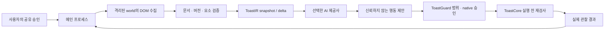

# ToastIR / ToastCore / ToastGuard — 0.4

ToastIR은 웹페이지 전체 코드나 화면을 무조건 보내는 대신, 실제 DOM에서 읽은 표시 텍스트와 조작 가능한 요소를 제한된 JSON으로 표현한다. CSS/스크립트 원문을 모델에게 실행 코드로 전달하지 않는다. 이 방식이 언제나 더 작거나 빠르다는 보장은 없으며 [실측](performance/GOLDEN-TOAST-0.4.md)을 별도로 기록한다.

## 모델 입력과 수명

`src/toastir/runtime.ts`가 world 1001에서 실제 Node를 WeakMap과 연결한다. 페이지의 같은 이름 전역변수·HTML ID로 이 매핑을 바꿀 수 없다. 문서 UUID, mutation version, 노드 속성/체크 상태/가시성 등의 fingerprint를 검사하며 shadow host를 포함한 composed ancestor에서 민감한 영역을 제외한다. MutationObserver와 실행 직전 동기 검사가 역할을 나누므로 동일 노드를 바꿨다 되돌리는 ABA도 무시하지 않는다.

수집 상한은 10,000 DOM 노드/500요소/12,000자/열린 shadow root 128개다. 모델에는 최대 100요소를 보낸다. 인터랙티브 요소를 먼저 유지하고, 한도를 넘으면 truncated를 기록한다. 긴 문서의 모든 내용이나 모든 접근성 의미를 추출했다는 뜻이 아니다.

`src/toastir/model.ts`는 `toastir/1` snapshot의 요소를 `[id, role, name, actions]` 튜플로 만든다. 이어지는 delta는 `baseVersion`, 제거 ID, 변경 행, 순서, 바뀐 본문을 갖는다. origin/document/source가 같고 정확한 기준 version에서 전체 snapshot과 동일하게 복원되며 더 작을 때만 선택한다. decoder는 권한을 만들지 않는다.

일회 공유는 다음 전송 한 번에만 사용한다. 승인된 workflow에는 메모리 wire history의 기준 원본과 후속 delta가 있다. 16메시지/30,000자 경계를 넘기거나 중지·연결/문서/모델이 바뀌면 리셋한다. 제공사에는 stateless 요청 이력도 포함되므로 각 delta 크기를 실제 토큰·전체 API 요청 크기와 혼동하면 안 된다. 로컬 대화 보관본에는 이 페이지 frame을 넣지 않는다.

모델에는 페이지와 실행 관찰을 각각 `untrusted_page_context`, `untrusted_execution_result`로 전달한다. 사용자 목표와 구분한다. DOM 동작 전달 성공은 결제·게시·저장 성공이 아니다. 자동으로 같은 제출을 재시도하지 않는다. 일시정지/불확실 상태를 표시하고 정확한 근거가 있는 모델의 `done:true` 완료 보고만 구분한다.

## 실행 경로 검토

| 경로 | 현재 상태 | 장점 / 제한과 선택 근거 |
| --- | --- | --- |
| 격리된 DOM + 구조화 명령 | 실제 production 경로 | 요소/문서 검증과 동기 dispatch 가능. shadow/가시성 검사는 비용이 들며 iframe·닫힌 shadow·canvas 내용은 읽지 않음 |
| 일반 DOM 직접 호출 | 테스트 비교 기준만 | 단순 `.click()`은 빠르지만 사용자 승인·문서 검사 없음. 모델에게 arbitrary JS를 제공하는 경로로 쓰지 않음 |
| 브라우저 자동화/CDP | 테스트 드라이버만 | 탭/OS fixture 제어에 유용하나 광범위 권한을 모델에게 열지 않음. Chrome 비교의 CDP overhead를 구분 |
| Chromium 전체 AX 트리 | 분석 완료, 미구현 | canvas/접근성 의미 보완 가능. 새로운 ID·프레임·취소 바인딩/비공개 필터 필요 |
| 시각 기반 | 미구현 | DOM 없는 화면에 유용할 수 있으나 이미지 비용·오인식·좌표 바뀜·개인정보 위험을 별도 검증해야 함 |
| 배치 실행 | 미구현 | 왕복 감소 가능하지만 각 이벤트의 부작용과 stale state를 승인·회수할 설계가 필요. 현재 한 행동 후 재수집 |

실험에서 직접 DOM 호출보다 Guard가 붙은 실행 시간이 길어지는 것은 검사 비용을 포함하기 때문이다. 정확도/토큰/작업 완료 시간의 실서비스 비교는 실제 모델과 동일 작업으로 추가 측정해야 한다. BTIR binary codec, 모델 JSON, screenshot 크기는 서로 다른 표현이며 동일한 정보 범위라고 가정하지 않는다.

## 중단과 권한

메인은 모델의 op/target/value만 받아 실제 document/tab/origin/version을 결합한다. UI/모델의 approved·scope·임의 code 필드는 거부한다. CLICK/FILL/SELECT/SCROLL/NAVIGATE는 정확한 인자에 묶인 native 일회성 승인과 범위를 요구한다. 만료·재사용·요소 교체·회수·다른 탭은 거부한다. 비밀번호·파일·민감 필드 조작은 허용하지 않는다.

수집은 5초에 타임아웃하고 scope를 회수한다. 이미 renderer에 들어간 작업을 강제로 중단했다고 주장하지 않으며 timeout 뒤 결과는 권한으로 사용하지 않는다. 승인된 원격 요청의 효과를 소급 취소할 수 없다. 사람 탭 직접 입력·전환과 전역 중지는 공유/권한을 회수한다. 읽기 전용 공유는 실행 권한이 아니다.
