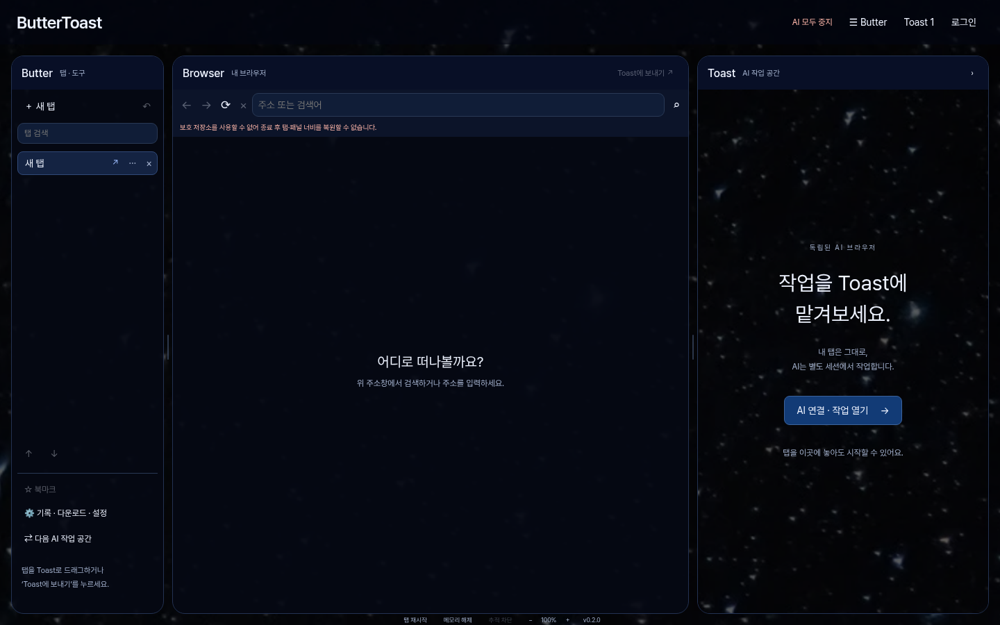

# ButterToast 0.2 기능·보안 확장

오너의 3패널과 별 배경을 유지하면서 폰트·탭 도구·AI 복구·다운로드 경계를 확장했다. 버전과 설치파일 이름을 0.2.0으로 변경해 이전 0.1.0 파일과 구분한다.

## 폰트와 화면

- Pretendard Variable 1.3.9를 앱에 포함한다. 네트워크나 외부 폰트 CDN이 없어도 동일하게 표시한다. SIL OFL과 원본 출처·해시는 `src/fonts`에 있고 라이선스는 설치 패키지에도 들어간다.
- ButterToast 바로 아래 문구를 삭제했다. 제목용 `--display-family`와 본문용 `--font-family`는 별도 토큰이다.
- JASO Sans는 정확한 배포처·폰트 파일·재배포 조건을 확인하지 못해 포함하지 않았다. 다른 폰트를 JASO Sans라고 표시하지 않는다. 추후 확인된 파일을 제목 토큰에 적용할 수 있다.
- 앱 하단에 실제 앱 버전과 확대 비율을 표시한다. 계정·설정·AI 화면에도 같은 로컬 폰트를 사용한다.

## 새 기능 사용법

| 기능 | 사용 방법 / 범위 |
| --- | --- |
| 탭 검색 | Butter의 검색란. 제목과 사이트 이름으로 필터한다. `Ctrl+Shift+A`로 포커스, Enter로 첫 결과 선택, Esc로 필터 해제 |
| 탭 고정 | 탭의 `⋯` 또는 오른쪽 클릭 → 탭 고정. 고정 탭을 앞에 모으고 일반 탭과 이동 경계를 분리 |
| 음소거 | 같은 메뉴 → 탭 음소거 / 소리 켜기. 현재 실제 WebContents와 복원 시 상태에 적용 |
| 주소 복제 | 같은 메뉴 → 탭 복제. 주소를 GET으로 열며 원본 입력값·POST 본문은 복제하지 않음 |
| 다른 탭 닫기 | 네이티브 확인 후 대상 탭 외 일반 탭만 닫음. 고정 탭 유지. 확인 중 새로 생긴 탭은 대상에 추가하지 않음 |
| 닫은 탭 복원 | `Ctrl+Shift+T`, 최대 최근 20개. 주소·고정·음소거만 복원 |
| 페이지 내 찾기 | 중앙 주소창 옆 찾기 또는 `Ctrl+F`. Enter/F3 다음, Shift+Enter/Shift+F3 이전, Esc 닫기. 현재 사람 탭에만 적용 |
| 확대·축소 | 하단 −/비율/＋ 또는 `Ctrl` + `+`, `-`, `0`. 50–300% 범위. Chromium의 동일 사이트 확대 정책 사용 |
| 모든 AI 중지 | 상단 버튼 또는 `Ctrl+Shift+X`. 숨겨진 슬롯까지 3개 작업의 요청·공유·대기 중 제안을 회수 |
| AI 페이지 복구 | 충돌/로딩 실패 상태 화면의 복구 버튼. 네이티브 확인 후 새 독립 세션에서 주소만 다시 열기. 이전 명령은 자동 재실행하지 않음 |

탭 세션 v2는 기존 v1 URL 목록을 읽으며 고정·음소거 상태를 OS 암호화해 저장한다. 페이지 내용·폼·POST·AI 승인 상태를 저장하지 않는다. 이전 0.1.0 앱으로 되돌리면 v2 탭 목록을 읽지 못하므로 기존 버전으로의 탭 복원은 보장하지 않는다. OS 보호 저장소가 없으면 현재 실행 중에만 유지한다.

## 보안 보완

1. 중지 명령은 정확한 발신 UI/프레임/스키마 검증을 유지하면서 일반 요청 제한을 우회할 수 있다. 가능한 효과는 권한·실행의 회수뿐이다. 웹의 DOM 키보드 이벤트로 네이티브 중지 단축키를 발생시킬 수 없다.
2. 중지 세대 번호로 대기 중인 탭 위임·결과 가져오기·복구 확인을 무효화한다. 중지 후 늦게 승인해도 새 작업을 열지 않는다. 기존 실행기 일회성 승인/문서 검증도 유지한다.
3. AI 작업 렌더러 충돌 시 요청과 공유 권한을 회수하고 상태 화면으로 전환한다. 복구는 새 임시 세션을 쓰므로 작업 사이트 로그인·쿠키·입력은 복원하지 않는다.
4. 사람 탭 충돌 뒤 주소 탐색은 새 WebContents로 교체한다. 같은 논리 탭을 유지하며 기존의 고장 난 뷰를 해제한다.
5. 다운로드 확인은 원래 WebContents·프레임·URL과 탐색 이벤트에 묶는다. 저장 위치 확인 중 같은 URL을 다시 불러와도 이전 동의를 폐기한다. 리디렉션 체인과 최종 URL을 저장 직전에 재검증한다.
6. 긴 파일명에서도 확장자를 보존하고, 방향 제어·보이지 않는 문자·Windows 특수 장치 이름을 정리한다. 저장 이름을 실행 가능한 형식으로 바꾼 경우 다시 확인한다.
7. Windows의 완료 파일에 인터넷 출처 `ZoneId=3`을 기록한다. 전체 URL의 토큰·query·fragment 대신 origin만 넣는다. 지원되지 않는 파일시스템 등 기록 실패는 다운로드 목록에 표시한다. 악성코드 검사나 SmartScreen 판정 결과가 아니다.
8. 폰트는 한 개의 고정된 앱 자산 경로만 허용하며 CSP는 `font-src 'self'`, `connect-src 'none'`을 유지한다. 샌드박스·TLS·사이트 격리·키 암호화는 유지한다.

이미 외부 서버에 전송된 동작은 중지로 되돌릴 수 없다. 기본 다운로드 허용/거부·사이트 권한·모델 출력 검증·읽기/제어 공유 경계는 기존 회귀와 함께 검사한다.

## 검증

새 `test:upgrade`는 실제 Electron에서 폰트, 탭 메뉴·검색, 페이지 찾기/좌표·확대, 일괄 닫기 승인, 다운로드 탐색 경합, 다중 AI 중지와 지연 응답, 위임 중지, 대기 동작 승인 무효화, 충돌 복구의 9개 그룹을 검사한다. 로컬 HTTPS protocol fixture와 가짜 모델 응답을 사용하며 실제 API 호출이나 공용 사이트 공격은 하지 않는다.

로컬 검증에서 단위 테스트 86개와 Electron 112개 그룹이 통과했다. 기존 102개 그룹에 업그레이드 9개와 사이트 데이터 삭제 후 다운로드 1개를 추가했다. npm audit 보고 취약점은 0건이며 지원 비밀정보 패턴은 미검출이었다. 전체 앱 회귀는 `/tmp/bt-upgrade-full-security.log`, 다운로드 경로 보완 후 단위 검증은 `/tmp/bt-upgrade-final-unit.log`에 기록했다. Windows·Ubuntu CI 결과는 해당 커밋의 Actions에서 확인한다. Windows CI는 실제 NTFS 다운로드의 `Zone.Identifier`도 읽어 확인한다.

엔진은 npm의 최신 안정 버전 조회에서 Electron 45.2.3임을 확인했다. 의존성을 불필요하게 교체하지 않았다. npm audit과 비밀정보 패턴 검사는 완전한 취약점/정보 유출 탐지가 아니다.

최초 CI는 Electron 공식 다운로드 URL의 504 오류로 설치 단계에서 멈췄다. 기본 경로 실패 시 같은 공식 GitHub 릴리스의 asset API로 내려받는 대체 경로를 추가했다. npm lockfile로 고정된 Electron 패키지의 체크섬, 공식 API의 버전·자산 URL·크기·해시, 실제 파일 바이트를 검사한 후 Electron 자체 설치기로 설치한다. 체크섬 검증이나 TLS를 끄지 않는다. 패키징도 패키지의 체크섬을 사용해 원격 체크섬 파일 장애에 영향을 덜 받게 했다.

## 남은 검증

- JASO Sans의 정확한 파일과 앱 재배포 조건.
- Windows 11 실제 설치·덮어설치·제거, 사용자 환경의 키보드·파일시스템·화면 배율 동작.
- 실제 유료/로컬 모델의 추론, 복잡한 사이트에서의 작업 성공률·비용·성능. 이번 테스트는 모델 성능 향상의 증거가 아니다.
- Authenticode 코드 서명, 운영 업데이트 서버/키와 일반 사용자용 SMTP. 현재 빌드는 미서명 개발용 사전 릴리스다.

## 주요 코드

`browser/tabs.ts`, `session-store.ts`, `tab-menu.ts`는 탭·복원을, `main.ts`와 제한된 IPC는 단축키·주체 검증을 담당한다. `ai/panel.ts`와 `workspaces.ts`는 중지·복구를 소유한다. `browser/downloads.ts`와 `download-policy.ts`는 저장 승인·출처 표시를 소유한다. 시각 변경은 `tokens.css`, `index.html`, `style.css`와 독립 UI 컴포넌트에 두었다.
