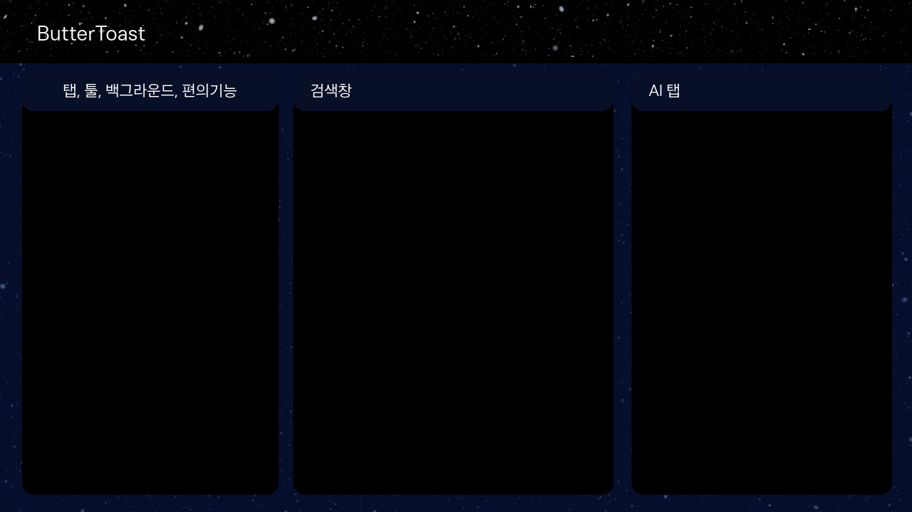

# 오너 제공 디자인 브리프

2026-11-08 전달. 기존 구현의 보안 경계를 유지하며 적용한다. 원본 HTML의 텍스트와 두 번째 레이아웃 시안을 기준으로 한다. 오너는 중심 정렬·선·간격 등 세부 보정을 허용했다.

ButterToast — Codex 구현 지시서
🧈🍞 ButterToast — Codex 구현 지시서
사용자가 직접 제작한 디자인 원본을 포함한 UI·아키텍처·상호작용 명세. 기존 프로젝트를 유지하면서 단계적으로 적용할 것.
최우선 지시:
이 문서는 새로운 브라우저를 처음부터 다시 만들라는 요청이 아니다. 기존 ButterToast 구현을 조사하고 현재 기능·보안 경계를 보존한 상태에서, 아래 사용자 확정 디자인을 기준으로 구현하라. 이미지의 화면 구성은 임의로 재설계하지 말 것. 미구현 사항은 구현 완료로 주장하지 말 것.
1. 제품의 정체성
ButterToast는 일반 브라우저에 AI 채팅 사이드바를 붙인 제품이 아니다.
사람용 웹 브라우저와 AI 전용 웹 브라우저가 같은 창에서 독립적으로 작동하며, 사람이 작업을 AI에게 넘기고 결과를 돌려받는 협업 브라우저
다. Chrome·Arc의 브라우저 완성도를 그대로 모방하기보다, 기존 Chromium 기반의 안정성 위에 독특한 AI 협업 경험을 구축한다.
2. 확정 3패널 레이아웃
영역
역할
필수 동작
왼쪽 Butter
탭, 툴, 북마크, 워크스페이스, 백그라운드 및 편의 기능
탭 탐색/정리, 도구 접근, 중앙 탭을 AI 작업으로 드래그 전달
중앙 Browser
사용자가 직접 쓰는 일반 Chromium 웹 브라우저
주소·검색 입력, 페이지 탐색, 사용자 독립 작업; AI가 오른쪽에서 작업하는 동안 중단되지 않음
오른쪽 Toast
AI가 실제로 페이지를 열고 조작하는 전용 브라우저/작업 공간
AI 작업 화면, 광속 상태 화면, 작업 제어, 진행 로그, 사용자 개입
각 패널 경계는 마우스로 드래그하여 너비를 조절하고, 너비를 저장·복원한다. 좌우 패널 독립 접기/펼치기, 최소 너비 제약, 작은 창에서의 적응형 레이아웃을 지원한다. 패널 비율은 고정 1:1:1이 아니다. 사용자가 제공한
수정된 3패널 시안
을 주 레퍼런스로 사용한다. 우주/별 배경과 짙은 남색 상단 바의 분위기를 유지하되 웹페이지 가독성과 성능을 우선한다.
3. 작업 넘기기: 사람 ↔ AI
중앙에서 열린 탭/페이지를 왼쪽 탭 영역 또는 중앙 탭에서 오른쪽 Toast로 드래그하여 작업을 위임한다. 명시적인 'Toast에 보내기' 메뉴도 접근성 대안으로 제공한다.
원본 중앙 탭과 사용자의 작업 상태는 유지한다. AI는 별도 작업 탭/세션에서 진행한다.
드롭 시 페이지 URL, 선택된 텍스트, 작업 지시, 허용된 페이지 컨텍스트를 전달할 수 있게 설계한다. 인증정보·쿠키·민감 데이터는 자동 공유하지 않는다.
AI 작업 결과의 링크, 요약, 검증 결과 및 필요시 결과 탭을 중앙으로 가져올 수 있게 한다.
사용자가 AI 작업을 일시정지·취소·재개하거나 직접 개입할 수 있다. 중복 클릭·동시 수정·작업 충돌을 방지한다.
4. Toast 오른쪽 패널의 두 표시 모드
A. 광속 작업 상태 화면 (기본)
첨부 별 배경 시안처럼
“AI 에이전트가 작업을 수행 중입니다”
문구와
“작업화면 보기”
버튼을 제공한다. 실제 진행 단계, 현재 대상 사이트/작업, 오류·승인 요청, 일시정지/중단 수단은 접근 가능해야 한다. 단순히 화면을 숨긴다고 성능이 빨라지는 것은 아니므로, 렌더링·모델 입력·반복 탐색 최적화의 효과를 따로 측정한다.
B. 실제 작업화면 보기
버튼을 누르면
같은 AI 작업 세션
의 실제 웹페이지를 오른쪽에 표시한다. 첨부 Chess.com 이미지는 'AI가 실제 웹사이트를 조작하는 화면'의 시각적 예시일 뿐이며 체스 UI를 복제하거나 체스 전용 기능을 구현하라는 뜻이 아니다. 광속 상태 ↔ 작업화면 표시 전환 시 작업을 재시작하거나 브라우저 세션을 새로 만들지 않는다. AI 작업과 사용자 중앙 브라우징은 서로 독립적이다.
5. ToastIR / ToastCore / ToastGuard
ToastIR:
DOM 및 접근성 트리를 정규화하고 AI에게 필요한 의미 구조를 간결하게 전달하는 중간 표현. 안정적 요소 식별자, 상태 변경분(Delta), 모델별 어댑터를 지향한다. 구현 상태를 먼저 확인하고 미구현은 계획으로 표시할 것.
ToastCore:
AI의 요소 탐색·클릭·입력·스크롤·탭 전환 등 작업을 수행하며, 행동 성공과 실제 페이지 결과를 구분해 검증한다.
ToastGuard:
AI/사용자 세션 경계, 최소 권한, 위험 작업 승인, 비밀정보 보호, 신뢰할 수 없는 페이지 내용에 의한 프롬프트 인젝션 방어를 담당한다. 결제·발송·삭제·권한 변경 등 민감 행동은 명시적 사용자 확인 없이 자동 실행하지 않는다.
6. 광속 커서 시각화 — 상징적인 UX
작업화면을 열면 AI 커서가 매우 빠르게 화면을 이동하며 작업하는 듯한 연출을 제공한다. 다만 DOM/API 기반 작업에는 물리적인 커서 이동이 없을 수 있으므로,
실제 작업 이벤트와 연결된 가상 커서
를 사용한다. 대상 요소 위치로 빠르게 이동, 클릭 하이라이트, 파란색 잔상/궤적, 단계별 이벤트 로그를 제공한다. 실제 실행 기록과 시각적 재생을 구분하며 '실제 커서 이동'이라고 허위 표현하지 않는다. 빠른 이벤트를 놓치지 않도록 타임스탬프와 대상 요소 정보를 기록한다.
관찰 옵션은
실시간/1×/0.5×/0.1×
등을 검토한다. 느린 재생은 기록의 시각화 속도만 바꾸고 실제 AI 실행 속도를 강제로 늦추지 않는다. 화면과 로그가 과도하게 번쩍이거나 눈을 피로하게 만들지 않도록 잔상 강도·애니메이션 끄기·모션 감소 설정을 지원한다. 사용자는 언제든 실제 작업을 중단할 수 있다.
7. UI 세부 요구사항
우측 Toast는
웹페이지가 주인공
이고 채팅 입력/작업 지시는 보조 UI다. 오른쪽을 단순 챗봇 사이드바로 만들지 말 것.
작업 상태 화면의 별 배경은 사용자가 제공한 이미지와 문구를 우선 참고한다. 버튼은 클릭 가능하고 명확한 상태 전환을 수행해야 한다.
좌우 패널의 제목 바, 모서리 둥글기, 어두운 네이비 톤과 간격은 수정 시안의 분위기를 따른다. 실제 브라우저의 주소 입력과 조작 기능은 빠뜨리지 않는다.
각 패널 크기 조절 중 웹 콘텐츠 뷰포트와 좌표계, 가상 커서 오버레이를 동기화한다.
AI 세션이 표시되지 않을 때도 상태 추적, 취소, 권한 승인과 작업 기록은 정상 동작해야 한다.
패널 전환·창 크기 변경·새로고침·탭 전환 시 작업의 연속성과 사용자 데이터 안전을 검증한다.
8. 단계별 구현 우선순위
현황 조사:
기존 Electron/Chromium 구조, 탭·세션, ToastIR/Core/Guard 구현 범위, 보안 설정과 테스트를 확인한다.
1단계 UI:
3패널 구조, 드래그 크기 조절, 너비 기억, 좌우 접기, 실제 중앙 브라우저 표시, Toast 상태 화면.
2단계 AI 작업:
중앙→Toast 작업 넘기기, 별도 작업 탭/세션, 광속 상태 ↔ 실제 작업화면 전환, 취소·재개·권한 승인.
3단계 시각화:
이벤트 기반 가상 커서, 클릭 하이라이트, 잔상, 타임라인 및 느린 재생.
4단계 성능/안정성:
ToastIR 변경분·토큰 절감·작업 성공률·지연시간 벤치마크, 오류 복구, 리소스 소비 측정.
9. 필수 수용 테스트
중앙에서 사용자가 탐색하는 동안 오른쪽 AI가 독립 작업을 계속한다.
중앙 탭을 Toast로 넘겨도 원본 탭이 닫히거나 내용이 임의 변경되지 않는다.
상태 화면에서 작업화면 보기로 전환해도 같은 작업·세션이 유지된다.
가상 커서는 실제 AI 작업 이벤트에 대응하고, 재생 속도 조절은 실제 실행을 느리게 만들지 않는다.
패널 리사이즈 후 웹뷰·커서 좌표가 어긋나지 않는다.
민감한 동작은 승인 없이 수행되지 않으며 세션 정보가 의도치 않게 공유되지 않는다.
ToastIR 사용 전후 토큰 수, 시간, 성공률을 동일 조건으로 비교해 과장 없이 보고한다.
10. Codex에 요청하는 산출물
기존 코드와 시안의 차이 분석, 변경 파일 목록, 단계별 구현 내용, 자동/수동 테스트 결과, 남은 제약과 위험을 한국어로 보고한다. 구현 불가능하거나 위험한 기능은 조용히 생략하지 말고 대안을 제시한다.
사용자 확정 디자인의 역할 구분(왼쪽 편의 / 중앙 사람 / 오른쪽 AI)을 절대 뒤바꾸지 말 것.
11. 사용자 원본 디자인 레퍼런스 (HTML에 이미지 내장)
아래 이미지들은 외부 파일 없이 이 HTML 하나에서 열리도록 내장되어 있다. 수정된 3패널 시안이 레이아웃의 우선 기준이며, Chess.com 이미지는 작업 화면의 역할 예시다.
초기 3패널 구상
초기 레이아웃 참고. 이후 수정본이 우선.
최종 3패널 레이아웃
주요 UI 기준. 사용자가 패널 너비 조절.
AI 작업 브라우저 표시 예시
Chess.com 콘텐츠는 샘플일 뿐. 체스 기능을 구현하라는 뜻이 아님.
광속 작업 상태 화면
별 배경, 진행 메시지, 작업화면 보기 동작의 기준.
ButterToast • Design-to-implementation brief • 2026-11-08